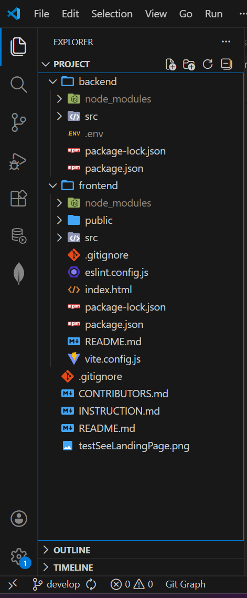
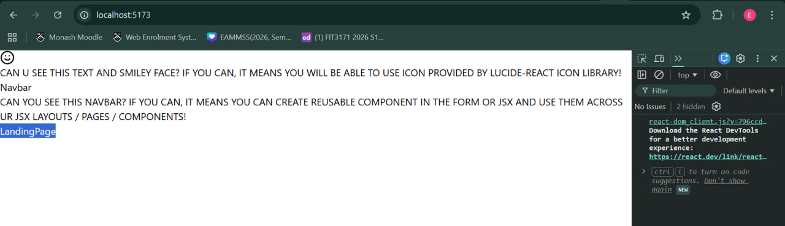

# FIT3170 Team 4 Project

## Steps to initialise the project in your branch
1. Clone this repository.

2. Install dependencies in backend
```bash
cd backend
npm install
```

3. After installing dependencies in backend, you should see a new node_module folder in your backend folder.

4. Setup backend/.env file
- create a .env file in your backend folder
- get the env keys from Team 4 FIT3170 Whatsapp Group Chat
- paste the key into the .env file you created

5. Install dependencies in frontend
```bash
cd frontend
npm install
```
6. After installing dependencies in frontend, you should see a new node_module folder in your frontend folder.

7. Your final directory should look like this:



## A: How to test run the project (backend)
1. Run the backend
```bash
cd backend
npm run dev
```

2. You should be expected to see the following printed to your terminal:
```
Server is running on port: 5001
MongoDB connected: ac-kyhyagh-shard-00-00.b4wrtb3.mongodb.net
Cloudinary connected: {
  status: 'ok',
  rate_limit_allowed: 500,
  rate_limit_reset_at: 2026-04-02T16:00:00.000Z,
  rate_limit_remaining: 499
}
```

3. If you cannot see the Cloudinary connection message, remember to uncomment off the code at bottomost of backend/src/index.js.

4. If any error shows up, it means you havent installed the dependencies correctly or set up your environment variables in .env correctly. Please reach out to the SA team in discord for assistance.

## B: How to test run the project (frontnend)
1. Run the frontend
```bash 
cd frontend 
npm run dev
```
2. Open the link generated (eg: http://localhost:5173/)
3. Check if you can see the following display:



4. Similarly, go to the top of search bar and navigate to the following path:
- localhost:5173/login
- localhost:5173/sign-up
- localhost:5173/volunteer-dashboard
- localhost:5173/organisation-dashboard
- localhost:5173/admin-dashboard
- localhost:5173/tyuifbacdxfnafanxaynfgdybcaukaktgcu

5. You should see the 'LandingPage' text change accordingly to 'Login', 'SignUp', 'VolunteerDashboard', 'OrganisationDashboard', 'AdminDashboard', 'LandingPage'

6. If you are curious how this works, check out the ```frontend/src/App.jsx``` file
