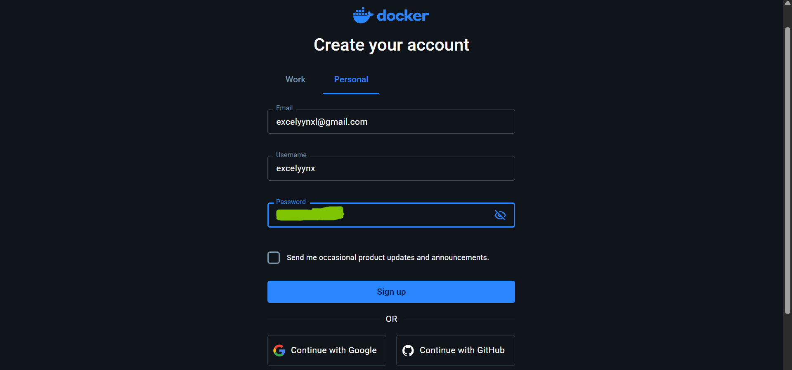
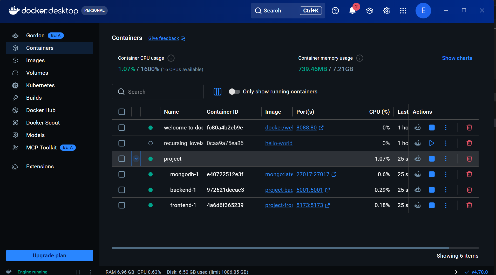
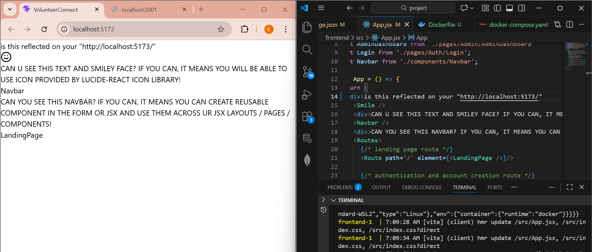
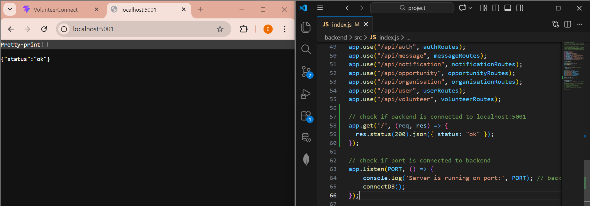
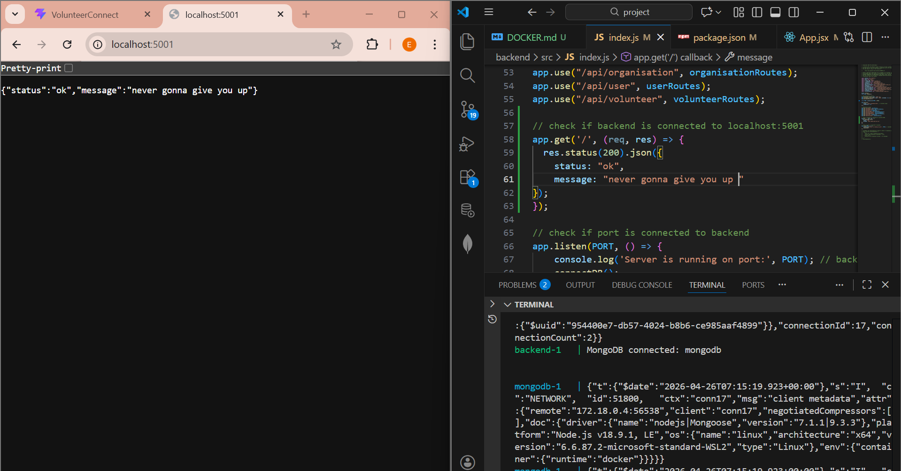

# FIT3170 Team 4 Project: Docker Setup

## Steps to install Docker Desktop
1. Install Docker Desktop via the [Official Docker Website](https://www.docker.com/products/docker-desktop/). Please follow along the video below to install.

2. Windows user: watch and follow along [How To Install Docker Desktop Window 11 (2026)](https://www.youtube.com/watch?v=5Mfe54238xE) to setup and verify Docker installation on your Windows device.

3. Mac user: Watch and follow along [How To Install Docker Desktop MacOS (2026)](https://www.youtube.com/watch?v=agkOZr27d3Y)  to setup and verify Docker installation on your MacOS device 

4. When you are creating your new Docker account, please select 'personal' and use your personal email as using you Monash student email will leads to account creation error. 



## Steps to check Docker connection
1. Prior to progressing into the next steps, make sure you have read and successfully ran instructions in the instructions/INSTRUCTION.md.

2. Open a new terminal and run
```bash
docker-compose up --build
```
Note that this process may take a few minutes (2-3 mins) and its totally normal to see alot of statement printed to your terminal in the process.

3. Open your Docker Desktop and check that all 3 containers (backend, frontend, mongodb) are connected, indicated by the green dot.


4. Make some random changes (eg: typing some words) to the <code>frontend/App.jsx</code> file and see if the changes are reflected on your <code>http://localhost:5173/</code>
. If reflected on both you <code>http://localhost:5173/</code> and terminal, this means your Docker frontend container is working on your local machine.

4. Navigate to the backend port on <code>http://localhost:5001/</code>, see if you get a <code>{"status":"ok"}</code> returned result.
 Try making some changes to <code>backend/src/index.js</code> by adding a return message line in the json <code>message: "never gonna give you up"</code>, refresh your <code>http://localhost:5001/</code>. If see get a <code>{"status":"ok","message":"never gonna give you up"}</code> and your terminal updated, this means your Docker backend is working on your local machine.


5. From now onwards, you will not be running:
```bash
cd backend
npm start
```
or
```bash
cd frontend
npm run dev
```
to carry out your development anymore. Instead, you will only need to run a single command:
```bash
docker-compose up
```